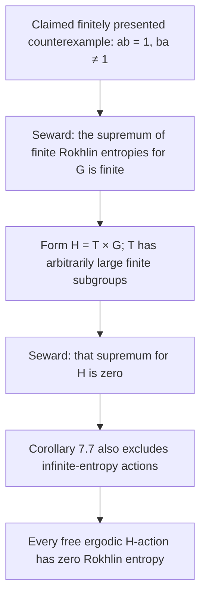

# 001 · From a group-algebra counterexample to universal zero Rokhlin entropy

**A conditional corollary, with consequences for generating partitions and entropy axioms.**

Research by **Roger Malcolm III**, using **GPT-6**.

[← All findings](../../README.md#findings) · [Detailed proof](proof.md) · [Verification record](verification.md) · [References](references.md)

| Record | Value |
| :--- | :--- |
| Finding ID | `001` |
| Author | Roger Malcolm III |
| Research assistance | GPT-6 |
| Version | `0.1.0` |
| Research date | October 7, 2026 |
| First published | October 8, 2026 |
| Mathematical status | Conditional on the cited group-algebra counterexample |
| Review status | AI-assisted source checks; no external review recorded |
| Areas | Ergodic theory · group rings · entropy · symbolic dynamics |

> [!IMPORTANT]
> The implication below uses established results of **Brandon Seward**. The new upstream input is a claimed counterexample in the OpenAI mathematics repository. We inspected its statement and declared formalization scope; we did **not** independently rebuild the Lean proof or audit its entire dependency chain. The present note is not itself formally verified, and priority for this application is not established.

## The finding

Assume there are a finite field $K$, a finitely presented group $G$, and elements $a,b\in K[G]$ such that

$$
ab=1,\qquad ba\ne 1.
$$

This is the input supplied by the cited characteristic-two manuscript. Let $T$ be Thompson's circle group and set $H=T\times G$. Then **$H$ is finitely presented, and every essentially free ergodic probability-measure-preserving action of $H$ on a standard probability space satisfies**

$$
h_H^{\mathrm{Rok}}(X,\mu)=0.
$$

The quantifier includes actions that might otherwise have infinite entropy. In particular, it includes the Bernoulli action on $[0,1]^H$ with product Lebesgue measure. [Sources: the claimed premise](references.md#s1), [Seward's transfer results](references.md#s2), and [Thompson's group](references.md#s4).

## In plain language

A generating observation is a measurement whose values across all group translates recover the measurable system. Rokhlin entropy asks how little Shannon entropy such an observation can have.

For the group $H$ above, that infimum would be zero for **every** free ergodic system. Even when an independent random real number sits at each group element, arbitrarily low-entropy observations can still recover the whole configuration from all their translates.

The finiteness assertion concerns the description of the symmetry group: $H$ has finitely many generators and defining relations. It is still an infinite group.

## Why it matters

### 1. A negative answer to universal positive-entropy existence

This would supply a finitely presented counterexample to the statement that every countably infinite group admits a free ergodic action of positive Rokhlin entropy. It also makes Rokhlin entropy unable to distinguish any free ergodic actions of this particular group. Equal entropy does not make those actions isomorphic.

The universal existence question and its connection to direct finiteness are already in Seward's work. This note applies that bridge to the newly claimed premise. [Source and theorem locations](references.md#s2).

### 2. Binary representations with an arbitrarily small marginal probability of a 1

For every fixed $0<\varepsilon<1$, each such action admits a two-part generating partition with probabilities $(\varepsilon,1-\varepsilon)$. Its translates give an equivariant, almost-everywhere invertible representation as a binary process. This applies even to the independent real-valued field. [Generator theorem](references.md#s3).

The output need not be independent. The probability $\varepsilon$ is a one-coordinate marginal, not a density along an unspecified averaging sequence. The representation may change with $\varepsilon$.

### 3. An obstruction for proposed entropy theories

Consider an isomorphism-invariant entropy $E$ on these actions. It cannot satisfy both:

1. **Bernoulli normalization:** the fair-bit Bernoulli shift has entropy one bit.
2. **Generator upper bound:** $E(X,\mu)\le H_\mu(\alpha)$ for every finite generating partition $\alpha$.

Indeed, the binary generators above would give

$$
E(X,\mu)\le H_2(\varepsilon)
=-\varepsilon\log_2\varepsilon-(1-\varepsilon)\log_2(1-\varepsilon)
\longrightarrow 0.
$$

Applied to the fair-bit Bernoulli shift, this contradicts normalization. This elementary deduction needs no continuity or monotonicity assumption. A universal entropy theory retaining one requirement would have to weaken the other or restrict the class of groups.

## The argument at a glance

The [proof](proof.md) states every hypothesis and includes a direct entropy-deficit check using the witness $1-ba$.

## Interpretation and limits

- **Global, measurable coding.** No effective encoder, decoder, runtime, or practical compression ratio is supplied. A fixed finite-neighborhood encoder cannot give this invertible real-to-binary representation; the proof explains why.
- **A correlated binary process.** We do not obtain an iid binary output or an isomorphism between Bernoulli shifts with different base entropies.
- **A specific group.** The result concerns $H=T\times G$, which has torsion. It does not assert the same conclusion for a torsion-free group, ordinary integer shifts, or every group.
- **A conditional application.** The upstream construction has not been independently certified here. No claim is made that this note is the first observation of the implication.

There is also a finite-window refinement: for any chosen finite window and tolerance, a suitable generating binary representation can be made arbitrarily close to iid biased bits on that window. The representation depends on the window and tolerance. [Details](proof.md).

## Provenance and revisions

The source repository is pinned to commit [`adc7f1241b42e322a6451854ab7e4b4c146bf78a`](https://github.com/openai/math/tree/adc7f1241b42e322a6451854ab7e4b4c146bf78a). The argument uses the September 23 characteristic-two finite-presentation statement; it does not require the later torsion-free strengthening.

Roger Malcolm III directed the initial investigation, which was researched and drafted using GPT-6, with separate agent passes over the implication and its interpretation. Those checks are recorded in [verification.md](verification.md), including prior-art search limits. They do not constitute external peer review.

**Suggested citation:** Roger Malcolm III. *From a group-algebra counterexample to universal zero Rokhlin entropy.* Legendary, Finding 001, version 0.1.0, 2026. Research assistance: GPT-6. [Repository note](https://github.com/LmeowLaunchpad/Legendary/tree/main/findings/001-rokhlin-entropy-collapse). For a fixed version, replace `main` in that URL with the commit being cited.

| Version | Change |
| :--- | :--- |
| `0.1.0` | Initial public note: conditional theorem, proof, entropy-axiom obstruction, and verification record. |
